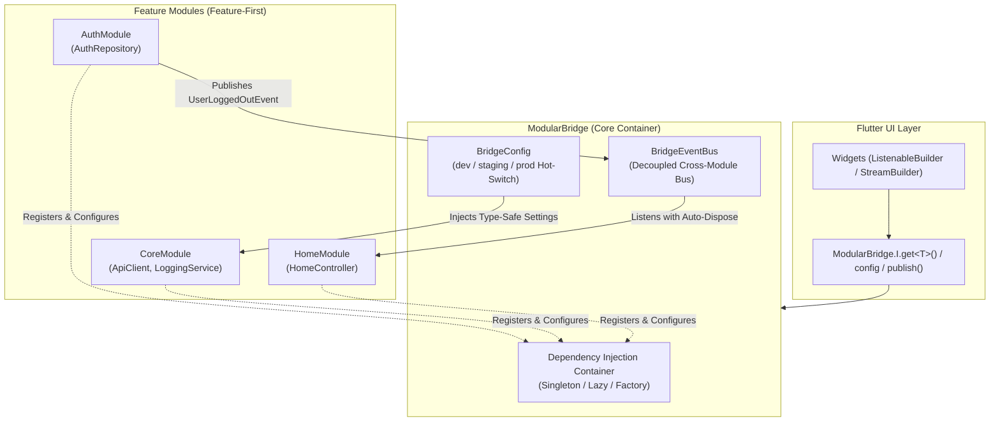

# Modular Bridge 🌉

[](https://pub.dev/packages/modular_bridge)
[](https://opensource.org/licenses/MIT)
[](https://flutter.dev)
[](https://dart.dev)
[](https://github.com/NefAnyo71/modular_bridge/actions)


**Modular Bridge** is a lightweight, high-performance, and **zero-external-dependency** architectural framework for large-scale, modular (Clean Architecture / Feature-first) Flutter projects. It solves **cross-module dependency injection, type-safe flavor/environment leakage, and decoupled event-driven communication** while preventing memory leaks out of the box.

---

## 📑 Table of Contents

- [Why Modular Bridge?](#-why-modular-bridge)
- [Architectural Overview](#-architectural-overview)
- [Installation](#-installation)
- [Quick Start & Step-by-Step Guide](#-quick-start--step-by-step-guide)
- [Choosing the right registration API](#choosing-the-right-registration-api)
  - [1. Type-Safe Flavor & Environment Management (`BridgeConfig`)](#1-type-safe-flavor--environment-management-bridgeconfig)
  - [2. Isolated Feature Module Declaration (`FeatureModule`)](#2-isolated-feature-module-declaration-featuremodule)
  - [3. Decoupled Event Bus (`BridgeEventBus`)](#3-decoupled-event-bus-bridgeeventbus)
  - [4. Flutter Widget Tree Integration](#4-flutter-widget-tree-integration)
  - [5. Testability & 1-Line Mock Overrides](#5-testability--1-line-mock-overrides)
  - [6. Advanced Capabilities](#6-advanced-capabilities)
- [Full End-to-End Runnable Example](#-full-end-to-end-runnable-example)
- [Error Handling (Sealed Exceptions)](#-error-handling-sealed-exceptions)
- [API Reference Cheat Sheet](#-api-reference-cheat-sheet)
- [Contributing](#-contributing)
- [License](#-license)

---

## 🌟 Why Modular Bridge?

In enterprise Flutter applications, as modules (`AuthModule`, `CartModule`, `PaymentModule`, etc.) expand, common architectural pitfalls inevitably arise:

1. **Tight Coupling:** The cart module needs to know when a user logs out, forcing it to directly import concrete classes like `AuthRepository` or `AuthBloc`. Changes in one module cascade and break unrelated modules.
2. **Stringly-Typed Configuration Bugs:** Environment variables (`apiBaseUrl`, `timeout`, feature flags) are often scattered through unverified `Map<String, dynamic>` maps or loose environment files. Missing keys or runtime type mismatches lead to production crashes.
3. **Memory Leaks:** Cross-module stream and event bus listeners are easily forgotten, accumulating zombie subscriptions that silently exhaust device memory.
4. **Tedious Testing Setups:** Mocking a single dependency often requires instantiating an entire monolithic dependency graph or overriding global service locators.

**The Modular Bridge Solution:**
- ✅ **Zero External Dependencies:** Pure Dart package built entirely on the Dart SDK — zero third-party packages, works on Dart VM, CLI tools, backend servers, and Flutter apps.
- ✅ **Module-Scoped Lifecycle & Automatic Disposal:** When a module is unregistered or the bridge is reset, all module-owned dependencies and event subscriptions are **automatically cancelled and disposed**.
- ✅ **Type-Safe Environment & Hot-Switching:** Strictly typed accessors (`getString`, `getInt`, `getDuration`, etc.) with instant compile-time/runtime verification and runtime hot-switch capability.
- ✅ **Decoupled Event Bus:** Modules communicate exclusively through strongly-typed domain events, without importing each other's internal concrete classes.
- ✅ **1-Line Mock Overrides:** Swap any registered dependency with a mock or fake via `bridge.override<T>(mockInstance)` in a single line.
- ✅ **Async-Ready DI & Request Scopes:** `registerAsyncSingleton`/`getAsync` for asynchronous resources, plus `BridgeScope` for per-request/session dependencies that dispose together.
- ✅ **Rich Event Primitives:** Type-safe publish/subscribe with auto-disposal, `onLatest` replay, `history`, `once<T>()`, publish counters, and event interceptors.
- ✅ **Advanced DI Controls:** Scoped config overrides, config bindings, resolution interceptors, retry policies, dependency metrics, diagnostics, and DevTools extensions.

---

## 🏗 Architectural Overview



---

## 📦 Installation

`modular_bridge` is a single pure Dart package with zero dependencies — it works identically in Flutter apps, Dart CLI tools, and backend services.

Add it to your `pubspec.yaml`:

```yaml
dependencies:
  modular_bridge: ^0.13.0
```

Or add it from the command line:

```bash
flutter pub add modular_bridge   # or: dart pub add modular_bridge
```

Then import it anywhere:

```dart
import 'package:modular_bridge/modular_bridge.dart';
```

---

## ⚡ Pure Dart in 60 Seconds

No Flutter required — `modular_bridge` runs on the Dart VM, CLI tools, and backend servers:

```dart
import 'package:modular_bridge/modular_bridge.dart';

class ApiClient {
  ApiClient({required this.baseUrl});
  final String baseUrl;
}

final class UserLoggedInEvent extends BridgeEvent {
  UserLoggedInEvent({required this.userId, required this.email});
  final String userId;
  final String email;
}

Future<void> main() async {
  final bridge = ModularBridge.createIsolated();
  bridge.registerLazySingleton<ApiClient>(
    () => ApiClient(baseUrl: 'https://api.example.com'),
  );
  bridge.eventBus.on<UserLoggedInEvent>().listen(
    (e) => print('auth: ${e.userId} (${e.email})'),
  );

  final client = bridge.get<ApiClient>();
  print('client: ${client.baseUrl}');
  bridge.eventBus.publish(
    UserLoggedInEvent(userId: 'u_42', email: 'dev@example.com'),
  );

  await bridge.dispose();
}
```

Everything below works identically in pure Dart and Flutter — the widget layer is purely additive.

### Choosing the right registration API

| Need | Recommended API |
| --- | --- |
| One shared app-wide instance | `registerSingleton` |
| Create once, on first use | `registerLazySingleton` |
| Fresh instance per resolution | `registerFactory` |
| Async resource at startup | `registerSingletonAsync` / `registerAsyncSingleton(eager: true)` |
| Async resource on first use | `registerLazySingletonAsync` / `registerAsyncSingleton` |
| Fresh async instance per call | `registerFactoryAsync` |
| Per-request/session state | `BridgeScope` / `pushNewScope` |
| Runtime parameters | `registerFactoryParam` / `getParam` |
| Rebuild when config changes | `registerConfigBinding` |
| Retry transient async failures | `retryPolicy: BridgeRetryPolicy(...)` |
| Test override | `override<T>(mock)` or `createIsolated()` |

Every `register*` API has a short alias for the common cases:
`singleton`, `lazySingleton`, `transient`, `asyncSingleton`, and `bind`
(config binding) — identical signatures, available on both `ModularBridge`
and `BridgeScope`.

---

## 🚀 Quick Start & Step-by-Step Guide

> All step-by-step snippets below share one cohesive mini-project (`ApiClient`, `AuthRepository`, `UserLoggedInEvent`, `UserLoggedOutEvent`, `CartService`). Runnable, analyzed versions live in [`example/lib/mini_app.dart`](example/lib/mini_app.dart), [`example/test/readme_examples_test.dart`](example/test/readme_examples_test.dart), and the full multi-tab showcase [`example/lib/main.dart`](example/lib/main.dart).

### ⚡ Minimal example — running in 60 seconds

The smallest possible setup — everything else is detail:

```dart
import 'package:flutter/material.dart';
import 'package:flutter/services.dart' show rootBundle;
import 'package:modular_bridge/modular_bridge.dart';

class ApiClient {
  ApiClient({required this.baseUrl, this.timeout = const Duration(seconds: 30)});
  final String baseUrl;
  final Duration timeout;
  Future<bool> ping() async => true;
}

final class CoreModule extends FeatureModule {
  @override
  String get name => 'CoreModule';

  @override
  void registerDependencies(ModularBridge bridge) {
    bridge.registerSingleton<ApiClient>(
      ApiClient(baseUrl: bridge.config.getString('apiBaseUrl')),
    );
  }
}

Future<void> main() async {
  WidgetsFlutterBinding.ensureInitialized();

  final bridge = ModularBridge.I;
  bridge.setConfig(await BridgeConfig.fromAsset(
    'assets/config.json',
    loader: rootBundle.loadString,
  ));
  await bridge.registerModules([CoreModule()]);

  // Resolve anywhere with a single line:
  final api = bridge.get<ApiClient>();
  debugPrint('API base URL: ${api.baseUrl}');

  runApp(const MaterialApp(home: Scaffold(body: Center(child: Text('Ready')))));
}
```

That's it — module, DI, config and the event bus are ready. Every piece is detailed below.

### 1. Type-Safe Flavor & Environment Management (`BridgeConfig`)

Define shared and flavor-specific (`dev`, `staging`, `prod`) configurations under one type-safe roof:

```dart
final config = BridgeConfig(
  environment: BridgeEnvironment.dev,
  commonValues: {
    'appName': 'SuperApp',
    'supportEmail': 'support@superapp.com',
  },
  environmentValues: {
    BridgeEnvironment.dev: {
      'apiBaseUrl': 'https://dev.api.superapp.com',
      'apiTimeout': const Duration(seconds: 30),
      'enableBiometrics': false,
      'retryCount': 3,
    },
    BridgeEnvironment.staging: {
      'apiBaseUrl': 'https://staging.api.superapp.com',
      'apiTimeout': const Duration(seconds: 15),
      'enableBiometrics': true,
      'retryCount': 2,
    },
    BridgeEnvironment.prod: {
      'apiBaseUrl': 'https://api.superapp.com',
      'apiTimeout': const Duration(seconds: 5),
      'enableBiometrics': true,
      'retryCount': 1,
    },
  },
);

// Bind to ModularBridge
ModularBridge.I.setConfig(config);
```

#### Reading Type-Safe Values:
```dart
// Throws a descriptive BridgeConfigException on type mismatch or missing required keys:
final String baseUrl = config.getString('apiBaseUrl');
final Duration timeout = config.getDuration('apiTimeout');
final bool biometrics = config.getBool('enableBiometrics');
final int retries = config.getInt('retryCount', defaultValue: 1);
```

#### Runtime Flavor Hot-Switching:
```dart
// Switch to production at runtime; all stream listeners and reactive widgets rebuild!
config.switchEnvironment(BridgeEnvironment.prod);
```

#### Loading Config from JSON

Pass any string loader into `BridgeConfig.fromAsset` — in Flutter apps pass `rootBundle.loadString` (see [`example/lib/main.dart`](example/lib/main.dart) and [`example/assets/config.json`](example/assets/config.json)), or pass `File(path).readAsString` in pure Dart CLI/backend code:

```dart
// assets/config.json:
// {
//   "environment": "prod",
//   "common": { "appName": "SuperApp" },
//   "environments": {
//     "dev":  { "apiBaseUrl": "https://dev.api.superapp.com" },
//     "prod": { "apiBaseUrl": "https://api.superapp.com" }
//   }
// }

final config = await BridgeConfig.fromAsset(
  'assets/config.json',
  loader: rootBundle.loadString,
);
// or decode in-memory JSON: BridgeConfig.fromString(json) / BridgeConfig.fromJson(map)
// the `environment:` parameter overrides the JSON "environment" key when provided.
```

#### Loading Config from `.env` Files

`BridgeConfig.fromEnvString` / `fromEnvFile` parse dotenv files with zero dependencies (`KEY=VALUE`, `#` comments, optional quotes and `export` prefixes). The environment is taken from the `environment:` parameter or auto-detected from `BRIDGE_ENV` / `APP_ENV` / `ENVIRONMENT` keys inside the file:

```dart
// assets/.env:
//   BRIDGE_ENV=staging
//   API_BASE_URL=https://staging.api.example.com
//   API_TIMEOUT_MS=15000

final config = await BridgeConfig.fromEnvFile(
  'assets/.env',
  loader: rootBundle.loadString,
);
final baseUrl = config.getString('API_BASE_URL');
final timeout = config.getDuration('API_TIMEOUT_MS'); // coerced from int ms
```

Environment keys accept the same aliases as `BridgeEnvironment.fromString` (`"development"`, `"production"`, ...).

---

### 2. Isolated Feature Module Declaration (`FeatureModule`)

Each feature extends `FeatureModule`. Modules register their internal dependencies and explicitly declare prerequisite module dependencies. Continuing with our mini-project types (`ApiClient`, `UserLoggedInEvent`, `UserLoggedOutEvent`, `AuthRepository`, `AuthRepositoryImpl`):

```dart
// Shared domain events & contracts
final class UserLoggedInEvent extends BridgeEvent {
  UserLoggedInEvent({required this.userId, required this.email});
  final String userId;
  final String email;
}

final class UserLoggedOutEvent extends BridgeEvent {
  UserLoggedOutEvent({required this.userId, required this.reason});
  final String userId;
  final String reason;
}

abstract class AuthRepository {
  bool get isLoggedIn;
  String? get email;
  Future<void> login(String email);
  Future<void> logout();
}

class AuthRepositoryImpl implements AuthRepository {
  AuthRepositoryImpl({required ApiClient apiClient, required ModularBridge bridge})
      : _apiClient = apiClient,
        _bridge = bridge;

  final ApiClient _apiClient;
  final ModularBridge _bridge;

  bool _isLoggedIn = false;
  String? _email;

  @override
  bool get isLoggedIn => _isLoggedIn;

  @override
  String? get email => _email;

  @override
  Future<void> login(String email) async {
    assert(_apiClient.baseUrl.isNotEmpty);
    _isLoggedIn = true;
    _email = email;
    _bridge.publish(UserLoggedInEvent(userId: 'usr_123', email: email));
  }

  @override
  Future<void> logout() async {
    _isLoggedIn = false;
    _email = null;
    _bridge.publish(
      UserLoggedOutEvent(userId: 'usr_123', reason: 'User logged out manually'),
    );
  }
}

// 1. Core Infrastructure Module
final class CoreModule extends FeatureModule {
  @override
  String get name => 'CoreModule';

  @override
  void registerDependencies(ModularBridge bridge) {
    // Lazy Singleton: Instantiated upon first lookup and cached
    bridge.registerLazySingleton<ApiClient>(() {
      return ApiClient(
        baseUrl: bridge.config.getString('apiBaseUrl'),
        timeout: bridge.config.getDuration('apiTimeout'),
      );
    });
  }
}

// 2. Authentication Feature Module
final class AuthModule extends FeatureModule {
  @override
  String get name => 'AuthModule';

  // Requires CoreModule to be registered beforehand
  @override
  List<Type> get dependencies => [CoreModule];

  @override
  void registerDependencies(ModularBridge bridge) {
    bridge.registerLazySingleton<AuthRepository>(() {
      return AuthRepositoryImpl(
        apiClient: bridge.get<ApiClient>(),
        bridge: bridge,
      );
    });
  }
}
```

#### Initializing Modules:
```dart
await ModularBridge.I.registerModules([
  CoreModule(),
  AuthModule(),
]);
```

#### Async Module Registration

`registerDependencies` may return a `Future` (`FutureOr<void>`), so modules can perform asynchronous setup — reading files, opening connections — before `init` runs. Dependencies registered after `await` points are still attributed to the correct module, and parallel `registerModule` calls never leak ownership across modules:

```dart
class PreferencesStore {
  static Future<PreferencesStore> open() async => PreferencesStore();
}

class DatabaseClient {
  static Future<DatabaseClient> open() async => DatabaseClient();
  Future<void> close() async {}
}

final class DataModule extends FeatureModule {
  @override
  String get name => 'DataModule';

  @override
  Future<void> registerDependencies(ModularBridge bridge) async {
    final prefs = await PreferencesStore.open();
    bridge.registerSingleton<PreferencesStore>(prefs);
    bridge.registerAsyncSingleton<DatabaseClient>(
      DatabaseClient.open,
      onDispose: (db) => db.close(),
    );
  }

  @override
  Future<void> init(ModularBridge bridge) async {
    final db = await bridge.getAsync<DatabaseClient>();
    // ...
  }
}
```

If a module throws during dependency registration or `init`, its subscriptions
and registered dependencies are cleaned up and the original error is rethrown.

#### Module Health Checks

Override `healthCheck` to verify a module's runtime prerequisites (backend
connectivity, required config keys, ...). `bridge.checkModuleHealth()` runs it
for every registered module and returns per-module `ModuleHealthResult`s —
errors are captured instead of propagated:

```dart
final class ApiHealthModule extends FeatureModule {
  @override
  String get name => 'ApiHealthModule';

  @override
  Future<bool> healthCheck(ModularBridge bridge) async {
    final api = bridge.tryGet<ApiClient>();
    return api != null && await api.ping();
  }
}

final results = await ModularBridge.I.checkModuleHealth();
final healthy = results.every((r) => r.isHealthy);
```

#### Optional Dependencies and Module Initialization Errors
```dart
class AnalyticsService {
  void trackScreen(String name) {}
}

final class ReportsModule extends FeatureModule {
  @override
  String get name => 'ReportsModule';

  @override
  void init(ModularBridge bridge) {
    throw StateError('Missing report config');
  }
}

final bridge = ModularBridge.I;

// Returns null only when no AnalyticsService is registered.
final analytics = bridge.tryGet<AnalyticsService>();
analytics?.trackScreen('home');

try {
  await bridge.registerModule(ReportsModule());
} on StateError catch (error) {
  // Failed module registrations are rolled back before the original error
  // reaches this handler.
  print('Reports module failed to initialize: $error');
}
```

---

### 3. Decoupled Event Bus (`BridgeEventBus`)

Feature modules communicate solely by publishing and subscribing to **Domain Events**, without importing each other's internal classes.

#### Publishing an Event (`AuthRepositoryImpl`):
In the `AuthRepositoryImpl.logout()` implementation defined above, calling `logout()` clears the session and broadcasts:

```dart
_bridge.publish(
  UserLoggedOutEvent(userId: 'usr_123', reason: 'User logged out manually'),
);
```

#### Subscribing with Auto-Disposal (`CartModule`):
The `subscribe` helper in `FeatureModule` registers the subscription under the module's scope. When the module is unregistered or disposed, all subscriptions are **automatically cancelled to prevent memory leaks** (see [`example/lib/cart/cart_module.dart`](example/lib/cart/cart_module.dart)):

```dart
class CartService {
  final List<String> items = [];
  void clearCart() => items.clear();
}

final class CartModule extends FeatureModule {
  @override
  String get name => 'CartModule';

  @override
  void registerDependencies(ModularBridge bridge) {
    bridge.registerLazySingleton<CartService>(() => CartService());
  }

  @override
  void init(ModularBridge bridge) {
    final cartService = bridge.get<CartService>();

    // Listen to UserLoggedOutEvent WITHOUT importing any AuthModule internals:
    subscribe<UserLoggedOutEvent>(bridge, (event) {
      cartService.clearCart();
      print('User ${event.userId} logged out (${event.reason}), cart cleared.');
    });
  }
}
```

---

### 4. Flutter Widget Tree Integration

No extra Flutter wrapper package is needed — resolve dependencies directly from `ModularBridge.I` and react to environment switches or controller updates with standard Flutter widgets (`StreamBuilder`, `ListenableBuilder`, `AnimatedBuilder`):

```dart
import 'package:flutter/material.dart';
import 'package:modular_bridge/modular_bridge.dart';

class UserProfileCard extends StatelessWidget {
  const UserProfileCard({super.key});

  @override
  Widget build(BuildContext context) {
    final bridge = ModularBridge.I;
    final authRepo = bridge.get<AuthRepository>();

    // Rebuilds automatically whenever config.switchEnvironment(...) is called:
    return StreamBuilder<BridgeEnvironment>(
      stream: bridge.config.onEnvironmentChanged,
      initialData: bridge.config.environment,
      builder: (context, _) {
        return Card(
          child: ListTile(
            title: Text('User: ${authRepo.email ?? 'Guest'}'),
            subtitle: Text('Environment: ${bridge.config.environment.name}'),
            trailing: IconButton(
              icon: const Icon(Icons.logout),
              onPressed: () => authRepo.logout(),
            ),
          ),
        );
      },
    );
  }
}
```

<details>
<summary>Optional: copy-paste <code>BuildContext</code> extension (if you prefer <code>context.get&lt;T&gt;()</code> syntax)</summary>

```dart
import 'package:flutter/widgets.dart';
import 'package:modular_bridge/modular_bridge.dart';

extension ModularBridgeContextX on BuildContext {
  ModularBridge get bridge => ModularBridge.I;
  T get<T extends Object>({String? instanceName}) =>
      bridge.get<T>(instanceName: instanceName);
  T? tryGet<T extends Object>({String? instanceName}) =>
      bridge.tryGet<T>(instanceName: instanceName);
  BridgeConfig get config => bridge.config;
  void publish<T extends BridgeEvent>(T event) => bridge.publish(event);
}
```

</details>

---

### 5. Testability & 1-Line Mock Overrides

Unit and widget tests do not require complex wrapper setups. Override any dependency in a single line using `bridge.override<T>()` (see [`example/test/readme_examples_test.dart`](example/test/readme_examples_test.dart)):

```dart
import 'package:test/test.dart'; // or package:flutter_test/flutter_test.dart
import 'package:modular_bridge/modular_bridge.dart';

class MockAuthRepository implements AuthRepository {
  bool _isLoggedIn = false;
  String? _email;

  @override
  bool get isLoggedIn => _isLoggedIn;

  @override
  String? get email => _email;

  @override
  Future<void> login(String email) async {
    _isLoggedIn = true;
    _email = email;
  }

  @override
  Future<void> logout() async {
    _isLoggedIn = false;
    _email = null;
  }
}

void main() {
  test('Single-line mock override unit test', () async {
    // Create an isolated container to prevent test state leakage
    final bridge = ModularBridge.createIsolated();

    // Register original real dependency
    bridge.registerLazySingleton<AuthRepository>(
      () => AuthRepositoryImpl(
        apiClient: ApiClient(baseUrl: 'https://dev.api.example.com'),
        bridge: bridge,
      ),
    );

    // Override with mock in one line:
    bridge.override<AuthRepository>(MockAuthRepository());

    final authRepo = bridge.get<AuthRepository>();
    expect(authRepo, isA<MockAuthRepository>());

    await authRepo.login('dev@example.com');
    expect(authRepo.isLoggedIn, isTrue);
    expect(authRepo.email, 'dev@example.com');

    await bridge.dispose();
  });
}
```

---

### 6. Advanced Capabilities

> **Note:** Each subsection below is a focused snippet showing minimal stub types inline so it stands on its own; see [`example/lib/main.dart`](example/lib/main.dart) for a complete running app demonstrating these features together.

#### Async Dependencies (`getAsync`)

Dependencies backed by asynchronous resources (database connections, remote config, etc.) use `registerAsyncSingleton` and are resolved with `getAsync`. Concurrent calls share a single in-flight resolution, failed resolutions are retried automatically, and circular async chains are detected without deadlocking:

```dart
class DatabaseClient {
  DatabaseClient(this.url);
  final String url;
  static Future<DatabaseClient> connect(String url) async => DatabaseClient(url);
  Future<void> close() async {}
}

class FeatureFlags {}

// Inside a FeatureModule (or directly on bridge):
bridge.registerAsyncSingleton<DatabaseClient>(
  () => DatabaseClient.connect(bridge.config.getString('databaseUrl')),
  onDispose: (client) => client.close(),
);

// Anywhere:
final db = await bridge.getAsync<DatabaseClient>();
final maybe = await bridge.tryGetAsync<FeatureFlags>();
```

Calling `bridge.get<DatabaseClient>()` on an async dependency throws `BridgeAsyncDependencyException`.
For transient async resources use `registerFactoryAsync<T>()` — every `getAsync` produces a fresh instance.

#### Circular Dependencies (`Lazy<T>`)

When two dependencies genuinely reference each other, wrap one side in a `Lazy<T>` so it resolves on first access instead of during registration:

```dart
class ServiceA {
  ServiceA(this.lazyB);
  final Lazy<ServiceB> lazyB;
}

class ServiceB {
  ServiceB(this.a);
  final ServiceA a;
}

bridge.registerLazySingleton<ServiceA>(
  () => ServiceA(bridge.lazy<ServiceB>()),
);
bridge.registerLazySingleton<ServiceB>(
  () => ServiceB(bridge.get<ServiceA>()),
);

final a = bridge.get<ServiceA>();
final b = a.lazyB.value; // resolved on demand — no cycle
// or: await a.lazyB.resolveAsync() for async lifecycles
```

`Lazy` resolves through the normal lookup rules (named instances, scope chains via `scope.lazy<T>()`), so it behaves exactly like a deferred `get`. `await bridge.callAsync<T>()` is also available as the async counterpart of `bridge<T>()`.

#### Startup Readiness (`allReady` / `isReady`)

Pass `eager: true` to `registerAsyncSingleton` to start resolution at registration time. Eager async singletons participate in `allReady`, while lazy ones resolve on first `getAsync`:

```dart
bridge.registerAsyncSingleton<DatabaseClient>(
  () => DatabaseClient.connect('postgres://localhost/app'),
  eager: true,
  onDispose: (client) => client.close(),
);

// Wait for every eager async singleton (with optional timeout):
await bridge.allReady(timeout: const Duration(seconds: 10));

// Or wait for a single dependency:
await bridge.isReady<DatabaseClient>();

// Synchronous checks:
bridge.allReadySync();
bridge.isReadySync<DatabaseClient>();
```

#### Request/Session Scopes (`BridgeScope`)

`bridge.createScope()` creates an isolated registration context for per-request or per-session state. Scoped dependencies are invisible to sibling scopes, fall back through the scope hierarchy to the parent container for unregistered types, and are all disposed together. Scopes support every lifecycle — including `registerAsyncSingleton` and `registerFactoryAsync`:

```dart
class RequestContext {
  RequestContext({required this.userId});
  final String userId;
}

class SessionCache {
  static Future<SessionCache> open() async => SessionCache();
}

class AuthToken {
  AuthToken(this.value);
  final String value;
}

const userId = 'u_42';
final scope = bridge.createScope(scopeName: 'checkout');
scope.registerSingleton<RequestContext>(RequestContext(userId: userId));
scope.registerAsyncSingleton<SessionCache>(SessionCache.open);

final session = await scope.getAsync<SessionCache>();
// ... handle the request ...
await scope.dispose(); // disposes every scoped dependency, awaiting async hooks
```

Scopes form a hierarchy via `scope.createChildScope()` — a child resolves child → parent → bridge — and `bridge.createScopeAsync(init)` runs async setup, seals the scope against later registrations, and disposes it automatically if `init` fails:

```dart
final requestScope = await bridge.createScopeAsync((scope) async {
  scope.registerSingleton<AuthToken>(AuthToken('tok_123'));
});
```

#### Scope Stack

`pushNewScope` enables implicit scoping: registrations and resolutions flow through the top scope automatically — no explicit `scope.get` calls required:

```dart
const userId = 'u_42';
bridge.pushNewScope(scopeName: 'request', isFinal: true, init: (b) {
  b.registerSingleton<RequestContext>(RequestContext(userId: userId));
});

// bridge.get<T>() now resolves through the request scope first.
final ctx = bridge.get<RequestContext>();

await bridge.popScope(); // disposes scope-local dependencies
```

Additional stack controls: `pushNewScopeAsync`, `popScope`, `dropScope(name)`, `popScopesTill(name)`, `currentScope`, `currentScopeName`, `activeScopeNames`, `onScopeChanged`, and `resetScope()`.

Scope names must be **unique across all live scopes** on the same bridge — creating a scope whose name is already taken throws a `StateError`. The name is freed when the scope is disposed or popped, and anonymous scopes (`scopeName: null`) may always coexist.

Instances implementing `Disposable` (`FutureOr<void> onDispose()`) are disposed automatically when no explicit `onDispose` hook was registered. `bridge.allowReassignment = true` globally permits re-registration without `override: true`; note that a replaced registration's disposal runs asynchronously and may overlap the replacement's first resolution — call `unregister` first when ordered teardown matters.

#### Startup Orchestration (`signalsReady` / `dependsOn`)

Async singletons can opt into manual readiness signalling, and any registration can declare dependencies that must resolve before its factory runs:

```dart
class PaymentGateway {}

class CheckoutFlow {
  CheckoutFlow(this.cart, this.payments);
  final CartService cart;
  final PaymentGateway payments;
}

class SessionService implements WillSignalReady {
  Future<void> init() async {
    // ... heavy async work ...
    ModularBridge.I.signalReady(this);
  }
}

bridge.registerSingleton<SessionService>(
  SessionService(),
  signalsReady: true, // allReady() waits for signalReady(this)
);

bridge.registerSingletonWithDependencies<CheckoutFlow>(
  factoryFunc: (b) => CheckoutFlow(b.get<CartService>(), b.get<PaymentGateway>()),
  dependsOn: [
    dep<CartService>(),
    dep<PaymentGateway>(),
  ],
);
// dep<T>([name]) / DependencyKey.of<T>([name]) are shorthand aliases for
// DependencyKey(T, name); DependencyKey(CartService) remains valid too.

await bridge.allReady(timeout: const Duration(seconds: 10));
```

`registerSingletonAsync` / `registerLazySingletonAsync` are provided as convenient aliases for eager and lazy async singletons.

#### Parameterized Factories

Factories can receive two runtime parameters via `registerFactoryParam`. Cached variants memoize per `(param1, param2)` pair:

```dart
class HttpClient {
  HttpClient(this.baseUrl, this.timeoutSeconds);
  final String baseUrl;
  final int timeoutSeconds;
}

bridge.registerCachedFactoryParam<HttpClient, String, int>(
  (baseUrl, timeoutSeconds) => HttpClient(baseUrl, timeoutSeconds),
);

final client = bridge.getParam<HttpClient, String, int>(
  param1: 'https://api.example.com',
  param2: 30,
);
```

`registerFactoryParamAsync` / `registerCachedFactoryParamAsync` pair with `getParamAsync`. Parameters are not part of the registration key — one registration serves all parameter combinations.

#### Bulk Resolution & Dependency Graph

```dart
final allClients = bridge.getAll<HttpClient>();           // every named/unnamed registration
final allCaches = await bridge.getAllAsync<SessionCache>(); // async-aware variant

final graph = bridge.dependencyGraph();
if (graph.hasCycles) {
  print('Dependency cycles: ${graph.cycles}');
}
```

`registerModules` now initializes modules in dependency order (topological sort) and rejects cyclic module graphs. Multiple instances of the same module type may share a batch (they register under distinct `name`s), but a type-based `dependencies` entry that matches more than one batched instance throws a `StateError` — register the duplicates separately in that case.

#### Environment-Aware Modules

Gate a module to specific environments via `FeatureModule.environments` — it is skipped silently when `bridge.config.environment` is not in the list:

```dart
final class DebugModule extends FeatureModule {
  @override
  String get name => 'DebugModule';

  @override
  List<BridgeEnvironment>? get environments => [BridgeEnvironment.dev];

  @override
  void registerDependencies(ModularBridge bridge) { /* ... */ }
}
```

#### Inspector Hooks

`bridge.onDependencyEvents` streams every registration/unregistration across all scopes, `dependencyGraph().toDot()` exports the `dependsOn` graph for Graphviz, `bridge.metrics` records per-key resolution counts/cache-hit ratios/durations, and `bridge.enableDevTools()` registers `ext.modular_bridge.*` VM service extensions for live inspection — the extensions are process-wide and always report on the most recently enabled bridge, so calling it on a fresh container retargets the snapshot. `bridge.warmup()` eagerly resolves all singleton-style registrations at startup. Instances implementing `ShadowChangeHandlers` get `onGetShadowed`/`onLeaveShadow` callbacks when a scope registration shadows them.

Migrating from `get_it`? See [MIGRATION.md](MIGRATION.md) for a full cheat sheet. Run `dart test benchmark/` for resolution throughput numbers (roughly ~1M sync `get` ops/s and ~1.5M scope-fallback ops/s on a dev machine).

#### Resolution Interceptors

`addResolutionInterceptor` wraps every public resolution (`get`, `getAsync`, `getParam`, `getParamAsync`, and their scope-aware paths) in onion-style middleware. This is useful for logging, metrics, feature flags, authorization-style guards, caching decorators, or test instrumentation:

```dart
class FakePaymentGateway implements PaymentGateway {}

bridge.addResolutionInterceptor((request, next) {
  final sw = Stopwatch()..start();
  try {
    final value = next();
    print('${request.type} resolved in ${sw.elapsedMicroseconds}µs');
    return value;
  } catch (e) {
    print('${request.type} FAILED in ${sw.elapsedMicroseconds}µs: $e');
    rethrow;
  }
});

// Short-circuit example — substitute a mock without touching next():
bridge.addResolutionInterceptor((request, next) =>
    request.type == PaymentGateway ? FakePaymentGateway() : next());
```

Interceptors run in registration order (first added = outermost), receive a `BridgeResolutionRequest` (type, instance name, arguments, async flag), and may skip `next()` entirely. On synchronous resolutions they must return the value directly — returning a `Future` throws `BridgeAsyncInterceptorException`; use `getAsync`/`getParamAsync` for async middleware. When no interceptors are registered, resolution takes a zero-overhead fast path, and `dispose()` clears them. Ready-made helpers are available through `BridgeInterceptors.logging()` and `BridgeInterceptors.timing()`.

#### Lazy Singleton Reset

```dart
await bridge.resetLazySingleton<AuthRepository>();
await bridge.resetLazySingletons();          // active scope or root
await bridge.resetScope(disposeInstances: false);
```

#### Config-Bound Dependencies

`registerConfigBinding` ties a DI registration to a `BridgeConfig` key — the cached value is automatically reset and re-decoded on every effective config change:

```dart
class ApiConfig {
  ApiConfig(this.baseUrl);
  factory ApiConfig.fromMap(Map map) => ApiConfig(map['baseUrl'] as String);
  final String baseUrl;
  void close() {}
}

bridge.registerConfigBinding<ApiConfig>(
  configKey: 'api',
  decoder: (v) => ApiConfig.fromMap(v as Map),
  onDispose: (cfg) => cfg.close(),
);
```

##### Scoped Config Overrides

`BridgeScope` supports per-scope configuration overrides — ideal for request/session-scoped settings like tenant IDs or per-user feature flags. Overrides shadow the global `BridgeConfig` for `configValue` lookups and config-bound dependencies resolved through that scope, inherit down to child scopes, and die with the scope:

```dart
final scope = bridge.pushNewScope(scopeName: 'request');
scope.setConfigValue('tenant', 'acme');
scope.setConfigValue('api.baseUrl', 'https://acme.api.dev');

// Inside the scope (or via bridge.configValue while it's active):
final tenant = bridge.configValue<String>('tenant');        // 'acme'
final url = scope.configValue<String>('api.baseUrl');

// Config-bound deps registered in the scope re-decode automatically
// when an override changes:
bridge.registerConfigBinding<ApiConfig>(
  configKey: 'api',
  decoder: (v) => ApiConfig.fromMap(v as Map),
);
scope.setConfigValue('api', {'baseUrl': 'https://acme.api.dev'});

scope.removeConfigValue('tenant');  // back to global value
```

#### Event Interceptors

`BridgeEventBus.addEventInterceptor` wraps the publish pipeline in onion-style middleware — observe, transform, fan out, or veto events before they reach subscribers:

```dart
final class OrderPlacedEvent extends BridgeEvent {
  OrderPlacedEvent(this.total);
  final double total;
}

bridge.eventBus.addEventInterceptor((event, next) {
  if (event is OrderPlacedEvent && event.total < 0) return; // veto
  print('publishing ${event.runtimeType}');
  next(event);
});
```

Interceptors run onion-style in registration order. They may observe an event, transform it with `next(transformedEvent)`, fan it out by calling `next` multiple times, or veto it by not calling `next`. Only events that reach the end of the chain are counted in `totalPublished`/`publishCounts` and recorded in replay history. Use `removeEventInterceptor` / `clearEventInterceptors` to manage the pipeline; all interceptors are cleared on dispose.

#### Async Retry Policies

`registerAsyncSingleton`/`registerSingletonAsync`/`registerLazySingletonAsync`/`registerFactoryAsync` accept a `BridgeRetryPolicy` — transient network failures at startup get automatic retry with configurable backoff:

```dart
import 'dart:io';

bridge.registerAsyncSingleton<DatabaseClient>(
  () => DatabaseClient.connect('postgres://localhost/app'),
  retryPolicy: BridgeRetryPolicy(
    maxAttempts: 3,
    delay: const Duration(milliseconds: 200),
    backoff: 2.0,
    retryIf: (e) => e is SocketException,
  ),
);
```

`maxAttempts` includes the first attempt, `delay` is the base wait, and each retry multiplies the wait by `backoff`. `retryIf` lets you retry only transient errors. The policy also works for async registrations inside `BridgeScope`.

#### Event Replay & One-Shot Waits

`onLatest<T>()` replays the most recent matching event to each new listener (BehaviorSubject-style), and `once<T>()` completes with the next event or a `TimeoutException`:

```dart
// Replay latest auth state to a freshly opened screen:
bridge.onLatest<UserLoggedInEvent>().listen((e) => print('Welcome ${e.email}'));

// Wait for a one-time event:
final event = await bridge.once<OrderPlacedEvent>(
  timeout: const Duration(seconds: 30),
);
```

#### Modules-Ready Hook & Leak Inspection

`bridge.onModulesReady(callback)` fires whenever the module set becomes ready — after `registerModule(s)` completes — and re-arms when all modules are unregistered. In tests, `bridge.debugLeakReport()` / `bridge.assertNoLeaks()` surface leftover resolution state or subscriptions:

```dart
bridge.onModulesReady((b) {
  // All modules initialized — safe to start background work.
});
```

`BridgeConfig` also supports `onChanged` (reactive config stream), `remove(key)` / `removeRuntimeOverrides()` for runtime overrides, persistent `set`/`setAll` overrides across environment switches, and `getMap`/`getSection` for decoding nested config maps into typed objects.

---

## 💻 Full End-to-End Runnable Example

Copy and paste this self-contained snippet into your `main.dart` to run it immediately — or run [`example/lib/mini_app.dart`](example/lib/mini_app.dart) directly (see [`example/lib/main.dart`](example/lib/main.dart) for the full multi-tab showcase):

```dart
import 'package:flutter/material.dart';
import 'package:modular_bridge/modular_bridge.dart';

// -----------------------------------------------------------------------------
// 1. DOMAIN EVENTS
// -----------------------------------------------------------------------------
final class UserLoggedInEvent extends BridgeEvent {
  UserLoggedInEvent({required this.userId, required this.email});
  final String userId;
  final String email;
}

final class UserLoggedOutEvent extends BridgeEvent {
  UserLoggedOutEvent({required this.userId, required this.reason});
  final String userId;
  final String reason;
}

// -----------------------------------------------------------------------------
// 2. SERVICES & MODULES
// -----------------------------------------------------------------------------
class ApiClient {
  ApiClient({
    required this.baseUrl,
    this.timeout = const Duration(seconds: 30),
  });

  final String baseUrl;
  final Duration timeout;

  Future<bool> ping() async => true;
}

abstract class AuthRepository {
  bool get isLoggedIn;
  String? get email;
  Future<void> login(String email);
  Future<void> logout();
}

class AuthRepositoryImpl implements AuthRepository {
  AuthRepositoryImpl({
    required ApiClient apiClient,
    required ModularBridge bridge,
  })  : _apiClient = apiClient,
        _bridge = bridge;

  final ApiClient _apiClient;
  final ModularBridge _bridge;

  bool _isLoggedIn = false;
  String? _email;

  @override
  bool get isLoggedIn => _isLoggedIn;

  @override
  String? get email => _email;

  @override
  Future<void> login(String email) async {
    assert(_apiClient.baseUrl.isNotEmpty);
    _isLoggedIn = true;
    _email = email;
    _bridge.publish(UserLoggedInEvent(userId: 'usr_123', email: email));
  }

  @override
  Future<void> logout() async {
    _isLoggedIn = false;
    _email = null;
    _bridge.publish(
      UserLoggedOutEvent(
        userId: 'usr_123',
        reason: 'User logged out manually',
      ),
    );
  }
}

final class CoreModule extends FeatureModule {
  @override
  String get name => 'CoreModule';

  @override
  void registerDependencies(ModularBridge bridge) {
    bridge.registerLazySingleton<ApiClient>(
      () => ApiClient(
        baseUrl: bridge.config.getString('apiBaseUrl'),
        timeout: bridge.config.getDuration('apiTimeout'),
      ),
    );
  }
}

final class AuthModule extends FeatureModule {
  @override
  String get name => 'AuthModule';

  @override
  List<Type> get dependencies => [CoreModule];

  @override
  void registerDependencies(ModularBridge bridge) {
    bridge.registerLazySingleton<AuthRepository>(
      () => AuthRepositoryImpl(
        apiClient: bridge.get<ApiClient>(),
        bridge: bridge,
      ),
    );
  }
}

class HomeController extends ChangeNotifier {
  String message = 'Please log in.';

  void onUserLoggedIn(String email) {
    message = 'Welcome back, $email! Personalized feed loaded.';
    notifyListeners();
  }

  void onUserLoggedOut(String reason) {
    message = 'User logged out ($reason). Feed cleared.';
    notifyListeners();
  }
}

final class HomeModule extends FeatureModule {
  @override
  String get name => 'HomeModule';

  @override
  List<Type> get dependencies => [CoreModule];

  @override
  void registerDependencies(ModularBridge bridge) {
    bridge.registerLazySingleton<HomeController>(() => HomeController());
  }

  @override
  void init(ModularBridge bridge) {
    final controller = bridge.get<HomeController>();

    // Listen to Auth events in a completely decoupled fashion:
    subscribe<UserLoggedInEvent>(
      bridge,
      (e) => controller.onUserLoggedIn(e.email),
    );
    subscribe<UserLoggedOutEvent>(
      bridge,
      (e) => controller.onUserLoggedOut(e.reason),
    );
  }
}

// -----------------------------------------------------------------------------
// 3. APPLICATION INITIALIZATION
// -----------------------------------------------------------------------------
Future<void> main() async {
  WidgetsFlutterBinding.ensureInitialized();

  // 1. Initialize type-safe configuration
  final config = BridgeConfig(
    environment: BridgeEnvironment.dev,
    environmentValues: {
      BridgeEnvironment.dev: {
        'apiBaseUrl': 'https://dev.api.example.com',
        'apiTimeout': const Duration(seconds: 30),
      },
      BridgeEnvironment.prod: {
        'apiBaseUrl': 'https://api.example.com',
        'apiTimeout': const Duration(seconds: 10),
      },
    },
  );
  ModularBridge.I.setConfig(config);

  // 2. Register feature modules
  await ModularBridge.I.registerModules([
    CoreModule(),
    AuthModule(),
    HomeModule(),
  ]);

  runApp(const MyApp());
}

class MyApp extends StatelessWidget {
  const MyApp({super.key});

  @override
  Widget build(BuildContext context) {
    return MaterialApp(
      home: const HomeScreen(),
      debugShowCheckedModeBanner: false,
      theme: ThemeData(useMaterial3: true, colorSchemeSeed: Colors.indigo),
    );
  }
}

class HomeScreen extends StatelessWidget {
  const HomeScreen({super.key});

  @override
  Widget build(BuildContext context) {
    final bridge = ModularBridge.I;
    final authRepo = bridge.get<AuthRepository>();
    final homeController = bridge.get<HomeController>();
    final config = bridge.config;
    final colorScheme = Theme.of(context).colorScheme;

    return StreamBuilder<BridgeEnvironment>(
      stream: config.onEnvironmentChanged,
      initialData: config.environment,
      builder: (context, _) {
        return Scaffold(
          appBar: AppBar(
            backgroundColor: colorScheme.primary,
            foregroundColor: colorScheme.onPrimary,
            title: const Text('Modular Bridge Demo'),
            actions: [
              // Flavor Hot-Switch Button
              TextButton.icon(
                onPressed: () {
                  final nextEnv = config.environment.isDev
                      ? BridgeEnvironment.prod
                      : BridgeEnvironment.dev;
                  config.switchEnvironment(nextEnv);
                },
                icon: Icon(Icons.swap_horiz, color: colorScheme.onPrimary),
                label: Text(
                  config.environment.name.toUpperCase(),
                  style: TextStyle(
                    color: colorScheme.onPrimary,
                    fontWeight: FontWeight.bold,
                  ),
                ),
              ),
            ],
          ),
          body: Center(
            child: Padding(
              padding: const EdgeInsets.all(24.0),
              child: Column(
                mainAxisAlignment: MainAxisAlignment.center,
                children: [
                  Text(
                    'Active API Base URL: ${config.getString('apiBaseUrl')}',
                    style: const TextStyle(
                      fontWeight: FontWeight.bold,
                      fontSize: 16,
                    ),
                  ),
                  const SizedBox(height: 20),
                  ListenableBuilder(
                    listenable: homeController,
                    builder: (context, _) {
                      return Container(
                        padding: const EdgeInsets.all(16),
                        decoration: BoxDecoration(
                          color: colorScheme.primaryContainer,
                          borderRadius: BorderRadius.circular(12),
                        ),
                        child: Text(
                          homeController.message,
                          style: TextStyle(
                            fontSize: 16,
                            color: colorScheme.onPrimaryContainer,
                          ),
                          textAlign: TextAlign.center,
                        ),
                      );
                    },
                  ),
                  const SizedBox(height: 30),
                  Row(
                    mainAxisAlignment: MainAxisAlignment.center,
                    children: [
                      ElevatedButton.icon(
                        icon: const Icon(Icons.login),
                        label: const Text('Log In'),
                        onPressed: () => authRepo.login('developer@flutter.io'),
                      ),
                      const SizedBox(width: 16),
                      OutlinedButton.icon(
                        icon: const Icon(Icons.logout),
                        label: const Text('Log Out'),
                        onPressed: () => authRepo.logout(),
                      ),
                    ],
                  ),
                ],
              ),
            ),
          ),
        );
      },
    );
  }
}
```

---

## ⚠️ Error Handling (Sealed Exceptions)

`modular_bridge` leverages Dart 3's `sealed class` hierarchy so errors can be exhaustively matched and handled predictably:

```dart
class NonRegisteredService {}

try {
  final service = bridge.get<NonRegisteredService>();
} on BridgeDependencyNotFoundException catch (e) {
  print('Dependency not found: ${e.type}');
} on BridgeCircularDependencyException catch (e) {
  print('Circular dependency detected: ${e.message}');
} on BridgeConfigKeyNotFoundException catch (e) {
  print('Missing configuration key: ${e.key}');
} on BridgeConfigTypeMismatchException catch (e) {
  print('Type mismatch: key \'${e.key}\' expected ${e.expectedType}, but found ${e.actualType}.');
} on BridgeModuleMissingDependencyException catch (e) {
  print('Module registration failed: ${e.moduleName} requires prerequisite module ${e.missingDependency}.');
} on BridgeModuleInUseException catch (e) {
  print('Cannot unload ${e.moduleName}: still required by ${e.dependentModules}.');
} on BridgeAsyncDependencyException catch (e) {
  print('Async dependency ${e.type} must be resolved with getAsync<T>().');
}
```

---

## 📊 API Reference Cheat Sheet

| Class / Method | Description |
| :--- | :--- |
| `ModularBridge.I` / `.instance` | App-wide singleton dependency injection and module coordinator |
| `ModularBridge.createIsolated()` | Instantiates a fresh, isolated container for hermetic unit testing |
| `bridge.registerSingleton<T>(instance)` | Registers an eager singleton instance |
| `bridge.registerLazySingleton<T>(() => T())` | Registers a lazy singleton instantiated on first resolution and cached |
| `bridge.registerFactory<T>(() => T())` | Registers a factory producing a fresh instance on every call |
| `bridge.override<T>(mock)` / `overrideAsync` / `overrideFactory` | Replaces a dependency with a mock instance / async factory / transient factory in one line |
| `bridge.get<T>()` or `bridge<T>()` | Resolves the dependency of type `T` (or throws `BridgeDependencyException`) |
| `bridge.tryGet<T>()` | Returns `null` only when `T` is not registered; dependency creation errors propagate |
| `bridge.registerAsyncSingleton<T>(factory, {eager, retryPolicy})` | Registers an async singleton resolved via `getAsync<T>()`; `eager: true` starts resolution immediately and `retryPolicy` retries transient failures |
| `bridge.registerSingletonAsync<T>` / `registerLazySingletonAsync<T>` | Eager / lazy async singleton aliases; both accept `retryPolicy` |
| `bridge.registerFactoryAsync<T>(factory, {retryPolicy})` | Registers an async transient factory — fresh instance per `getAsync` with optional retry |
| `bridge.registerFactoryParam` / `registerCachedFactoryParam` (+`Async`) | Parameterized factories resolved via `getParam`/`getParamAsync` |
| `bridge.getParam` / `getParamAsync` | Resolves a parameterized factory with `(param1, param2)` |
| `bridge.getAll<T>()` / `getAllAsync<T>()` | Resolves every visible registration of a type |
| `bridge.dependencyGraph()` / `.toDot()` | `dependsOn` graph snapshot with cycle detection / Graphviz export |
| `bridge.onDependencyEvents` | Registration change stream for inspectors |
| `bridge.addResolutionInterceptor` / `removeResolutionInterceptor` / `clearResolutionInterceptors` | Onion-style middleware around `get`, `getAsync`, `getParam`, and `getParamAsync` |
| `BridgeInterceptors.logging` / `BridgeInterceptors.timing` | Ready-made resolution logging and timing interceptors |
| `bridge.eventBus.addEventInterceptor` / `removeEventInterceptor` / `clearEventInterceptors` | Onion-style publish middleware with observe/transform/fan-out/veto support |
| `BridgeRetryPolicy` | Retry/backoff configuration for async factories |
| `bridge.metrics` / `resetMetrics()` | Per-key + per-module resolution counts, cache hits, durations |
| `bus.totalPublished` / `bus.publishCounts` | Event bus publish counters per runtime type |
| `bridge.warmup()` / `warmup(ownerModule:)` | Eagerly resolves singleton-style registrations (optionally per module) |
| `bridge.enableDevTools()` | Registers `ext.modular_bridge.*` VM service extensions |
| `bridge.lastEvent<T>()` / `history<T>()` | Event snapshot / bounded replay stream |
| `FeatureModule.environments` | Restrict a module to specific `BridgeEnvironment`s |
| `bridge.assertRegistered` / `assertAllReadySync` / `pendingReadinessKeys` | Test helpers (`@visibleForTesting`) |
| `bridge.getAsync<T>()` / `tryGetAsync<T>()` | Async resolution; concurrent calls share one in-flight factory |
| `bridge.lazy<T>()` / `scope.lazy<T>()` / `Lazy<T>` | Deferred handle breaking circular dependencies; resolves via `.value` / `.resolveAsync()` |
| `bridge.callAsync<T>()` / `scope.callAsync<T>()` | Async counterpart of the `call` syntax |
| `FeatureModule.warmup(bridge)` | Startup hook run by `bridge.warmup()` after owned dependencies resolve |
| `bridge.dependencyEventHistory({count})` | Replay-then-live stream over bounded dependency-registration history |
| `bridge.allReady({timeout})` / `allReadySync()` | Waits for / checks all readiness-tracked registrations |
| `bridge.isReady<T>({timeout})` / `isReadySync<T>()` | Per-dependency readiness check |
| `bridge.signalReady(instance)` | Manually completes a `signalsReady` / `WillSignalReady` registration |
| `bridge.registerSingletonWithDependencies<T>` / `...Async` | Registers a singleton gated on `dependsOn` keys (sync or `FutureOr` factory) |
| `dep<T>([name])` / `DependencyKey.of<T>([name])` | Shorthand aliases for building `dependsOn` keys |
| `FeatureModule.healthCheck(bridge)` / `bridge.checkModuleHealth()` | Per-module health verification returning `ModuleHealthResult`s (with per-module `duration`) |
| `BridgeConfig.fromAsset(path, loader:)` / `fromString` / `fromJson` | Loads configuration from JSON (`loader: rootBundle.loadString` in Flutter) |
| `BridgeConfig.fromEnvString` / `fromEnvFile(path, loader:)` | Loads configuration from dotenv content/files; env auto-detected via `BRIDGE_ENV`/`APP_ENV`/`ENVIRONMENT` |
| `bridge.createScope()` / `createScopeAsync(init)` | Creates a `BridgeScope` (optionally with async sealed setup) |
| `bridge.pushNewScope` / `popScope` / `dropScope` / `popScopesTill` | Implicit scope stack |
| `bridge.isScopeActive(name)` / `findScope(name)` | Scope stack membership / live-scope lookup |
| `bridge.registerModule(m, checkHealth: true)` / `registerModules(ms, checkHealth: true, parallel: true)` | Auto-runs `healthCheck` after registration; failures reported via `bridgeErrorReporter`; `parallel` initializes same-depth modules concurrently |
| `bridgeErrorReporter` / `reportBridgeError` | Pluggable sink for framework-internal errors (default: `dart:developer.log`) |
| `bridge.currentScope` / `activeScopeNames` / `onScopeChanged` | Scope stack introspection and change callback |
| `bridge.resetScope()` / `resetLazySingleton(s)` | Clears current-scope registrations / resets lazy singletons |
| `bridge.reset({disposeInstances})` / `scope.dispose({disposeInstances})` | Full container/scope teardown; `false` skips instance disposal hooks |
| `bridge.registerConfigBinding<T>` | Config-key-bound dependency auto-reset on config change |
| `bridge.diagnosticsReport()` | Structured registrations/scopes/modules/pending-async snapshot |
| `scope.createChildScope()` | Creates a nested scope resolving child → parent → bridge |
| `scope.registerAsyncSingleton` / `registerFactoryAsync` | Full async lifecycle support inside scopes |
| `bridge.unregister<T>()` | Async-safe unregister awaiting disposal hooks; completes `true`/`false` for hit/miss |
| `bridge.dispose()` | Permanently disposes the container (use `reset()` to keep it usable) |
| `bridge.onLatest<E>()` | Event stream replaying the latest `E` to each new listener |
| `bridge.once<E>({timeout})` | Completes with the next `E` event or throws `TimeoutException`/`StateError` on dispose |
| `bus.hasListeners<E>({includeCatchAll})` | Checks for managed subscriptions; opt-in catch-all matching |
| `bus.clearReplayHistory()` | Releases retained latest-event references |
| `bridge.onModulesReady(cb)` | Callback fired whenever all modules finish registering |
| `bridge.moduleDependents(type)` | Lists modules that declare `type` as a dependency |
| `bridge.registeredDependencies` | Snapshot of all registered `DependencyKey`s |
| `config.onChanged` / `config.remove(key)` / `config.removeRuntimeOverrides()` | Reactive config stream / remove one or all runtime overrides |
| `config.getMap(key)` / `getSection<T>(key, decoder)` | Read nested config maps as typed objects |
| `bridge.publish<E>(event)` | Broadcasts a strongly-typed domain event to all active listeners |
| `bridge.on<E>()` | Subscribes to an event stream of type `E` |
| `module.subscribe<E>(bridge, onData, {onError, onDone, cancelOnError})` | Scoped subscription **automatically cancelled** when the module is disposed |
| `config.switchEnvironment(env)` | Performs a runtime hot-switch across `dev`, `staging`, and `prod` |
| `bridge.configValue<T>(key)` | Resolves config through the active scope chain with scope overrides |
| `scope.setConfigValue` / `removeConfigValue` / `hasConfigOverride` / `configOverrides` / `configValue` | Per-scope configuration overrides that inherit to child scopes |

---

## 🤝 Contributing

This project was developed with the assistance of AI tools under close human supervision — every change is reviewed, tested (`dart analyze` + `dart test`, `flutter analyze` + `flutter test`), and verified before release.

Want to contribute? Issues, pull requests, docs improvements, and bug reports are welcome on GitHub:

👉 **https://github.com/NefAnyo71/modular_bridge/**

If you find this package useful, consider giving it a ⭐ on [pub.dev](https://pub.dev/packages/modular_bridge) or the repository.

---

## 📄 License

This package is licensed under the [MIT License](LICENSE). Free for personal, commercial, and open-source use.
