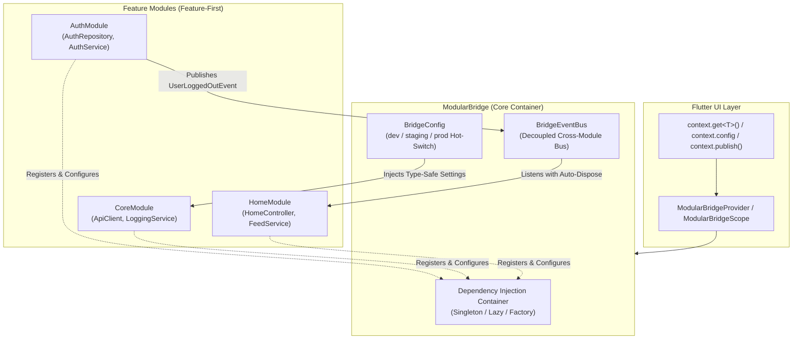

# Modular Bridge 🌉

[](https://pub.dev)
[](https://opensource.org/licenses/MIT)
[](https://flutter.dev)
[](https://dart.dev)

> 🇹🇷 **Türkçe Dokümantasyon:** Adım adım Türkçe kullanım kılavuzu için [KULLANIM_KILAVUZU.md](KULLANIM_KILAVUZU.md) dosyasına göz atabilirsiniz.

**Modular Bridge** is a lightweight, high-performance, and **zero-external-dependency** architectural framework for large-scale, modular (Clean Architecture / Feature-first) Flutter projects. It solves **cross-module dependency injection, type-safe flavor/environment leakage, and decoupled event-driven communication** while preventing memory leaks out of the box.

---

## 📑 Table of Contents

- [Why Modular Bridge?](#-why-modular-bridge)
- [Architectural Overview](#-architectural-overview)
- [Installation](#-installation)
- [Quick Start & Step-by-Step Guide](#-quick-start--step-by-step-guide)
  - [1. Type-Safe Flavor & Environment Management (`BridgeConfig`)](#1-type-safe-flavor--environment-management-bridgeconfig)
  - [2. Isolated Feature Module Declaration (`FeatureModule`)](#2-isolated-feature-module-declaration-featuremodule)
  - [3. Decoupled Event Bus (`BridgeEventBus`)](#3-decoupled-event-bus-bridgeeventbus)
  - [4. Flutter Widget Tree Integration (`BuildContext` Extensions)](#4-flutter-widget-tree-integration-buildcontext-extensions)
  - [5. Testability & 1-Line Mock Overrides](#5-testability--1-line-mock-overrides)
- [Full End-to-End Runnable Example](#-full-end-to-end-runnable-example)
- [Error Handling (Sealed Exceptions)](#-error-handling-sealed-exceptions)
- [API Reference Cheat Sheet](#-api-reference-cheat-sheet)
- [License](#-license)

---

## 🌟 Why Modular Bridge?

In enterprise Flutter applications, as modules (`AuthModule`, `CartModule`, `PaymentModule`, etc.) expand, common architectural pitfalls inevitably arise:

1. **Tight Coupling:** The cart module needs to know when a user logs out, forcing it to directly import concrete classes like `AuthRepository` or `AuthBloc`. Changes in one module cascade and break unrelated modules.
2. **Stringly-Typed Configuration Bugs:** Environment variables (`apiBaseUrl`, `timeout`, feature flags) are often scattered through unverified `Map<String, dynamic>` maps or loose environment files. Missing keys or runtime type mismatches lead to production crashes.
3. **Memory Leaks:** Cross-module stream and event bus listeners are easily forgotten, accumulating zombie subscriptions that silently exhaust device memory.
4. **Tedious Testing Setups:** Mocking a single dependency often requires instantiating an entire monolithic dependency graph or overriding global service locators.

**The Modular Bridge Solution:**
- ✅ **Zero External Dependencies:** Built entirely on top of the native Dart and Flutter framework. No transitive third-party package baggage.
- ✅ **Module-Scoped Lifecycle & Automatic Disposal:** When a module is unregistered or the bridge is reset, all module-owned dependencies and event subscriptions are **automatically cancelled and disposed**.
- ✅ **Type-Safe Environment & Hot-Switching:** Strictly typed accessors (`getString`, `getInt`, `getDuration`, etc.) with instant compile-time/runtime verification and runtime hot-switch capability.
- ✅ **Decoupled Event Bus:** Modules communicate exclusively through strongly-typed domain events, without importing each other's internal concrete classes.
- ✅ **1-Line Mock Overrides:** Swap any registered dependency with a mock or fake via `bridge.override<T>(mockInstance)` in a single line.

---

## 🏗 Architectural Overview



---

## 📦 Installation

Add `modular_bridge` to your `pubspec.yaml`:

```yaml
dependencies:
  modular_bridge: ^0.1.0
```

Fetch the package:

```bash
flutter pub get
```

Import it into your Dart codebase:

```dart
import 'package:modular_bridge/modular_bridge.dart';
```

---

## 🚀 Quick Start & Step-by-Step Guide

### 1. Type-Safe Flavor & Environment Management (`BridgeConfig`)

Define shared and flavor-specific (`dev`, `staging`, `prod`) configurations under one type-safe roof:

```dart
final config = BridgeConfig(
  environment: BridgeEnvironment.dev,
  commonValues: {
    'appName': 'SuperApp',
    'supportEmail': 'support@superapp.com',
  },
  environmentValues: {
    BridgeEnvironment.dev: {
      'apiBaseUrl': 'https://dev.api.superapp.com',
      'apiTimeout': const Duration(seconds: 30),
      'enableBiometrics': false,
      'retryCount': 3,
    },
    BridgeEnvironment.staging: {
      'apiBaseUrl': 'https://staging.api.superapp.com',
      'apiTimeout': const Duration(seconds: 15),
      'enableBiometrics': true,
      'retryCount': 2,
    },
    BridgeEnvironment.prod: {
      'apiBaseUrl': 'https://api.superapp.com',
      'apiTimeout': const Duration(seconds: 5),
      'enableBiometrics': true,
      'retryCount': 1,
    },
  },
);

// Bind to ModularBridge
ModularBridge.I.setConfig(config);
```

#### Reading Type-Safe Values:
```dart
// Throws a descriptive BridgeConfigException on type mismatch or missing required keys:
final String baseUrl = config.getString('apiBaseUrl');
final Duration timeout = config.getDuration('apiTimeout');
final bool biometrics = config.getBool('enableBiometrics');
final int retries = config.getInt('retryCount', defaultValue: 1);
```

#### Runtime Flavor Hot-Switching:
```dart
// Switch to production at runtime; all stream listeners and UI widgets rebuild instantly!
config.switchEnvironment(BridgeEnvironment.prod);
```

---

### 2. Isolated Feature Module Declaration (`FeatureModule`)

Each feature extends `FeatureModule`. Modules register their internal dependencies and explicitly declare prerequisite module dependencies:

```dart
// 1. Core Infrastructure Module
final class CoreModule extends FeatureModule {
  @override
  String get name => 'CoreModule';

  @override
  void registerDependencies(ModularBridge bridge) {
    // Lazy Singleton: Instantiated upon first lookup and cached
    bridge.registerLazySingleton<ApiClient>(() {
      return ApiClient(
        baseUrl: bridge.config.getString('apiBaseUrl'),
        timeout: bridge.config.getDuration('apiTimeout'),
      );
    });
  }
}

// 2. Authentication Feature Module
final class AuthModule extends FeatureModule {
  @override
  String get name => 'AuthModule';

  // Requires CoreModule to be registered beforehand
  @override
  List<Type> get dependencies => [CoreModule];

  @override
  void registerDependencies(ModularBridge bridge) {
    bridge.registerLazySingleton<AuthRepository>(() {
      final apiClient = bridge.get<ApiClient>();
      return AuthRepositoryImpl(apiClient: apiClient);
    });
  }
}
```

#### Initializing Modules:
```dart
await ModularBridge.I.registerModules([
  CoreModule(),
  AuthModule(),
]);
```

---

### 3. Decoupled Event Bus (`BridgeEventBus`)

Feature modules communicate solely by publishing and subscribing to **Domain Events**, without importing each other's internal classes.

#### Defining Domain Events:
```dart
final class UserLoggedOutEvent extends BridgeEvent {
  UserLoggedOutEvent({required this.userId, required this.reason});

  final String userId;
  final String reason;
}
```

#### Publishing an Event (`AuthModule`):
```dart
class AuthRepositoryImpl implements AuthRepository {
  @override
  Future<void> logout() async {
    // Perform session invalidation...
    
    // Broadcast decoupled event:
    ModularBridge.I.publish(
      UserLoggedOutEvent(userId: 'usr_123', reason: 'User logged out manually'),
    );
  }
}
```

#### Subscribing with Auto-Disposal (`CartModule`):
The `subscribe` helper in `FeatureModule` registers the subscription under the module's scope. When the module is unregistered or disposed, all subscriptions are **automatically cancelled to prevent memory leaks**:

```dart
final class CartModule extends FeatureModule {
  @override
  void init(ModularBridge bridge) {
    final cartService = bridge.get<CartService>();

    // Listen to UserLoggedOutEvent WITHOUT importing any AuthModule internals:
    subscribe<UserLoggedOutEvent>(bridge, (event) {
      cartService.clearCart();
      print('User logged out (${event.reason}), shopping cart cleared.');
    });
  }
}
```

---

### 4. Flutter Widget Tree Integration (`BuildContext` Extensions)

Wrap your root application with `ModularBridgeProvider` to supply the container and automatically propagate runtime flavor switches down the widget tree:

```dart
void main() async {
  WidgetsFlutterBinding.ensureInitialized();

  await ModularBridge.I.registerModules([
    CoreModule(),
    AuthModule(),
    HomeModule(),
  ]);

  runApp(
    const ModularBridgeProvider(
      child: MyApp(),
    ),
  );
}

class UserProfileCard extends StatelessWidget {
  const UserProfileCard({super.key});

  @override
  Widget build(BuildContext context) {
    // Direct dependency & config resolution via BuildContext extensions:
    final authRepo = context.get<AuthRepository>();
    final isProd = context.config.environment.isProd;

    return Card(
      child: ListTile(
        title: Text('User: ${authRepo.currentUserEmail}'),
        subtitle: Text('Environment: ${context.config.environment.name}'),
        trailing: IconButton(
          icon: const Icon(Icons.logout),
          onPressed: () => authRepo.logout(),
        ),
      ),
    );
  }
}
```

---

### 5. Testability & 1-Line Mock Overrides

Unit and widget tests do not require complex wrapper setups. Override any dependency in a single line using `bridge.override<T>()`:

```dart
import 'package:flutter_test/flutter_test.dart';
import 'package:modular_bridge/modular_bridge.dart';

class MockAuthRepository implements AuthRepository {
  @override
  Future<void> logout() async {}
}

void main() {
  test('Single-line mock override unit test', () {
    // Create an isolated container to prevent test state leakage
    final bridge = ModularBridge.createIsolated();

    // Register original real dependency
    bridge.registerLazySingleton<AuthRepository>(() => RealAuthRepository());

    // Override with mock in one line:
    bridge.override<AuthRepository>(MockAuthRepository());

    expect(bridge.get<AuthRepository>(), isA<MockAuthRepository>());
  });
}
```

---

## 💻 Full End-to-End Runnable Example

Copy and paste this self-contained snippet into your `main.dart` to run it immediately:

```dart
import 'package:flutter/material.dart';
import 'package:modular_bridge/modular_bridge.dart';

// -----------------------------------------------------------------------------
// 1. DOMAIN EVENTS
// -----------------------------------------------------------------------------
final class UserLoggedInEvent extends BridgeEvent {
  UserLoggedInEvent({required this.email});
  final String email;
}

final class UserLoggedOutEvent extends BridgeEvent {}

// -----------------------------------------------------------------------------
// 2. SERVICES & MODULES
// -----------------------------------------------------------------------------
abstract class AuthRepository {
  bool get isLoggedIn;
  String? get email;
  void login(String email);
  void logout();
}

class AuthRepositoryImpl implements AuthRepository {
  AuthRepositoryImpl(this._bridge);
  final ModularBridge _bridge;

  bool _isLoggedIn = false;
  String? _email;

  @override
  bool get isLoggedIn => _isLoggedIn;

  @override
  String? get email => _email;

  @override
  void login(String email) {
    _isLoggedIn = true;
    _email = email;
    _bridge.publish(UserLoggedInEvent(email: email));
  }

  @override
  void logout() {
    _isLoggedIn = false;
    _email = null;
    _bridge.publish(UserLoggedOutEvent());
  }
}

final class AuthModule extends FeatureModule {
  @override
  String get name => 'AuthModule';

  @override
  void registerDependencies(ModularBridge bridge) {
    bridge.registerLazySingleton<AuthRepository>(() => AuthRepositoryImpl(bridge));
  }
}

class HomeController extends ChangeNotifier {
  String message = 'Please log in.';

  void onUserLoggedIn(String email) {
    message = 'Welcome back, $email! Personalized feed loaded.';
    notifyListeners();
  }

  void onUserLoggedOut() {
    message = 'User logged out. Feed cleared.';
    notifyListeners();
  }
}

final class HomeModule extends FeatureModule {
  @override
  String get name => 'HomeModule';

  @override
  void registerDependencies(ModularBridge bridge) {
    bridge.registerLazySingleton<HomeController>(() => HomeController());
  }

  @override
  void init(ModularBridge bridge) {
    final controller = bridge.get<HomeController>();

    // Listen to Auth events in a completely decoupled fashion:
    subscribe<UserLoggedInEvent>(bridge, (e) => controller.onUserLoggedIn(e.email));
    subscribe<UserLoggedOutEvent>(bridge, (e) => controller.onUserLoggedOut());
  }
}

// -----------------------------------------------------------------------------
// 3. APPLICATION INITIALIZATION
// -----------------------------------------------------------------------------
void main() async {
  WidgetsFlutterBinding.ensureInitialized();

  // 1. Initialize type-safe configuration
  final config = BridgeConfig(
    environment: BridgeEnvironment.dev,
    environmentValues: {
      BridgeEnvironment.dev: {'apiBaseUrl': 'https://dev.api.example.com'},
      BridgeEnvironment.prod: {'apiBaseUrl': 'https://api.example.com'},
    },
  );
  ModularBridge.I.setConfig(config);

  // 2. Register feature modules
  await ModularBridge.I.registerModules([AuthModule(), HomeModule()]);

  runApp(
    const ModularBridgeProvider(
      child: MyApp(),
    ),
  );
}

class MyApp extends StatelessWidget {
  const MyApp({super.key});

  @override
  Widget build(BuildContext context) {
    return MaterialApp(
      home: const HomeScreen(),
      debugShowCheckedModeBanner: false,
      theme: ThemeData(useMaterial3: true, colorSchemeSeed: Colors.indigo),
    );
  }
}

class HomeScreen extends StatelessWidget {
  const HomeScreen({super.key});

  @override
  Widget build(BuildContext context) {
    final authRepo = context.get<AuthRepository>();
    final homeController = context.get<HomeController>();
    final config = context.config;

    return Scaffold(
      appBar: AppBar(
        title: const Text('Modular Bridge Demo'),
        actions: [
          // Flavor Hot-Switch Button
          TextButton.icon(
            onPressed: () {
              final nextEnv = config.environment.isDev
                  ? BridgeEnvironment.prod
                  : BridgeEnvironment.dev;
              config.switchEnvironment(nextEnv);
            },
            icon: const Icon(Icons.swap_horiz, color: Colors.white),
            label: Text(
              config.environment.name.toUpperCase(),
              style: const TextStyle(color: Colors.white, fontWeight: FontWeight.bold),
            ),
          ),
        ],
      ),
      body: Center(
        child: Padding(
          padding: const EdgeInsets.all(24.0),
          child: Column(
            mainAxisAlignment: MainAxisAlignment.center,
            children: [
              Text(
                'Active API Base URL: ${config.getString('apiBaseUrl')}',
                style: const TextStyle(fontWeight: FontWeight.bold, fontSize: 16),
              ),
              const SizedBox(height: 20),
              ListenableBuilder(
                listenable: homeController,
                builder: (context, _) {
                  return Container(
                    padding: const EdgeInsets.all(16),
                    decoration: BoxDecoration(
                      color: Colors.indigo.shade50,
                      borderRadius: BorderRadius.circular(12),
                    ),
                    child: Text(
                      homeController.message,
                      style: const TextStyle(fontSize: 16, color: Colors.indigo),
                      textAlign: TextAlign.center,
                    ),
                  );
                },
              ),
              const SizedBox(height: 30),
              Row(
                mainAxisAlignment: MainAxisAlignment.center,
                children: [
                  ElevatedButton.icon(
                    icon: const Icon(Icons.login),
                    label: const Text('Log In'),
                    onPressed: () => authRepo.login('developer@flutter.io'),
                  ),
                  const SizedBox(width: 16),
                  OutlinedButton.icon(
                    icon: const Icon(Icons.logout),
                    label: const Text('Log Out'),
                    onPressed: () => authRepo.logout(),
                  ),
                ],
              ),
            ],
          ),
        ),
      ),
    );
  }
}
```

---

## ⚠️ Error Handling (Sealed Exceptions)

`modular_bridge` leverages Dart 3's `sealed class` hierarchy so errors can be exhaustively matched and handled predictably:

```dart
try {
  final service = bridge.get<NonRegisteredService>();
} on BridgeDependencyNotFoundException catch (e) {
  print('Dependency not found: ${e.type}');
} on BridgeCircularDependencyException catch (e) {
  print('Circular dependency detected: ${e.message}');
} on BridgeConfigKeyNotFoundException catch (e) {
  print('Missing configuration key: ${e.key}');
} on BridgeConfigTypeMismatchException catch (e) {
  print('Type mismatch: key \'${e.key}\' expected ${e.expectedType}, but found ${e.actualType}.');
} on BridgeModuleMissingDependencyException catch (e) {
  print('Module registration failed: ${e.moduleName} requires prerequisite module ${e.missingDependency}.');
}
```

---

## 📊 API Reference Cheat Sheet

| Class / Method | Description |
| :--- | :--- |
| `ModularBridge.I` / `.instance` | App-wide singleton dependency injection and module coordinator |
| `ModularBridge.createIsolated()` | Instantiates a fresh, isolated container for hermetic unit testing |
| `bridge.registerSingleton<T>(instance)` | Registers an eager singleton instance |
| `bridge.registerLazySingleton<T>(() => T())` | Registers a lazy singleton instantiated on first resolution and cached |
| `bridge.registerFactory<T>(() => T())` | Registers a factory producing a fresh instance on every call |
| `bridge.override<T>(mock)` | Replaces an existing dependency with a mock instance in one line |
| `bridge.get<T>()` or `bridge<T>()` | Resolves the dependency of type `T` (or throws `BridgeDependencyException`) |
| `bridge.publish<E>(event)` | Broadcasts a strongly-typed domain event to all active listeners |
| `bridge.on<E>()` | Subscribes to an event stream of type `E` |
| `module.subscribe<E>(bridge, onData)` | Scoped subscription **automatically cancelled** when the module is disposed |
| `config.switchEnvironment(env)` | Performs a runtime hot-switch across `dev`, `staging`, and `prod` |
| `context.bridge` / `context.get<T>()` | Resolves container dependencies directly from `BuildContext` |
| `context.config` | Accesses active type-safe configuration from `BuildContext` |

---

## 📄 License

This package is licensed under the [MIT License](LICENSE). Free for personal, commercial, and open-source use.
